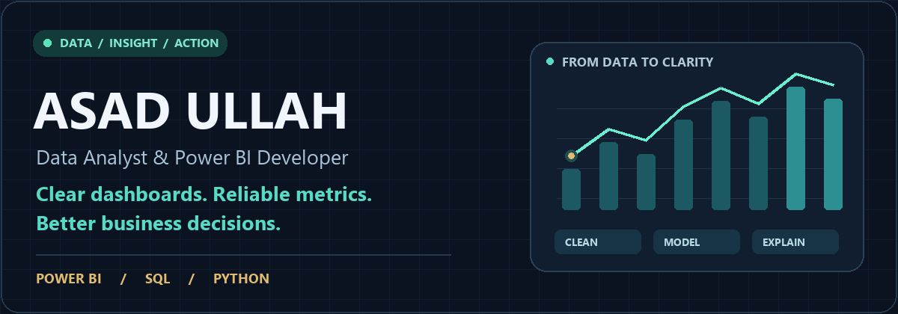

  

  
  &nbsp;
  

<strong>Open to Data Analyst · Power BI Developer · BI Analyst opportunities</strong> Available for freelance dashboard and reporting projects.

---

### Business questions → trusted reporting

I'm **Asad**, a Computer Science student building dashboards and Python workflows across healthcare, workforce reporting, customer engagement, and sales analytics.

I start with **what one row represents**, check data quality, define the KPIs, and validate the model before presenting the results.

| 📊 Business intelligence | 🛠️ Data & automation | 🔎 Applied AI practice |
| :--- | :--- | :--- |
| Power BI dashboards, DAX measures, fiscal calendars, and performance comparisons | SQL analysis, Power Query transformations, Pandas validation, and reusable reporting workflows | Document processing, retrieval experiments, and ML workflows with documented limitations |

### Selected work

| Project | What you can explore |
| :--- | :--- |
| **[Healthcare FTE & Encounter Analytics](https://github.com/AsadUllah786-prog/HealthCare-Dashboard)** | Workforce and encounter reporting, provider identity mapping, fiscal calendars, and budget variance. Includes a dashboard preview and Power BI template. |
| **[Client Engagement Intelligence](https://github.com/AsadUllah786-prog/client-engagement-intelligence)** | Dashboard preview covering outreach, mailings, invitations, response measures, and subscriptions. |
| **[Workforce Hours Reporting](https://github.com/AsadUllah786-prog/workforce-hours-reporting)** | Summary/detail dashboard preview for hours, departments, providers, pay categories, and period comparisons. |
| **[SQL Portfolio · Pizza Sales](https://github.com/AsadUllah786-prog/SQL-PortfolioProject)** | T-SQL queries using joins, CTEs, window functions, aggregations, and data-quality checks. |
| **[AI-Ops System Health Platform](https://github.com/AsadUllah786-prog/aiops-system-health-platform)** | Monitoring, anomaly detection, and health-scoring application architecture across React, Node.js, and FastAPI. |

Each repository identifies its available artifacts. Private client data and restricted PBIX files are not published.

### My toolkit

Also working with **Excel · NumPy · Matplotlib · data modeling · OCR/document processing**.

### Building in public · ML & GenAI

**[Explore the 16-week ML + GenAI repository →](https://github.com/AsadUllah786-prog/CSCI26504_ML_GenAI_16_Weeks)**

A structured, AI-assisted learning resource connecting data exploration, machine learning, retrieval, and API development.

| 84 notebooks executed | 18 tests passed | 3 project workflows |
| :---: | :---: | :---: |
| 80 daily lessons + EDA + projects | Documented local environment | Churn · segmentation · document retrieval |

What the validation covers

The repository includes a 28-section EDA playbook, reusable Python modules, and a local FastAPI/document-retrieval example. Dataset cards describe the Kaggle sources' generated or derived origins. Validation notes separate tested local workflows from optional integrations and deployment examples, and evaluation reports retain failure cases.

This is evidence of learning and reproducible engineering practice. Passing software tests does not establish commercial model performance.

### A little about me

🎓 Completing a **BS Computer Science** at the University of Veterinary and Animal Sciences, Lahore.  
🌱 Developing my analytics, Python automation, and applied AI skills through documented projects.  
💡 Interested in the work between a messy spreadsheet and a decision someone can trust.

### Have a reporting problem to solve?

Tell me your **business question, data sources, required KPIs, and timeline**. We can discuss the dashboard or workflow that fits your needs.

**[Let's talk on LinkedIn ↗](https://www.linkedin.com/in/asadanalyst/)** &nbsp; · &nbsp; **[Browse my portfolio ↗](https://asad-ullah-data-portfolio.wigglylily128.chatgpt.site/)**
